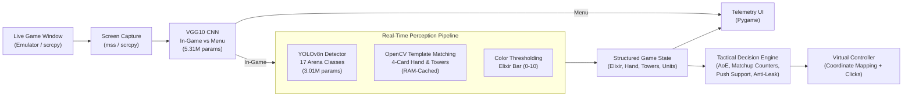

# Clash Royale Real-Time AI Agent — Computer Vision & Tactical Decision Pipeline


An end-to-end **real-time perception-to-action AI agent** that plays *Clash Royale* directly from raw screen pixels—without reading game memory or hooking internal APIs. The system combines a custom **PyTorch CNN (`VGG10`)**, a fine-tuned **YOLOv8 object detector**, **OpenCV HUD state extraction**, and a **hierarchical tactical decision engine** into a closed-loop autonomous pipeline.

---

## System Architecture




---

## Deep Learning & Computer Vision Pipeline

| Component | Model / Method | Specs & Role |
| :--- | :--- | :--- |
| **Match State Classifier** | Custom `VGG10` CNN (PyTorch) | **5.31M parameters**, 224×224 RGB ImageNet-normalized input, trained with `CrossEntropyLoss` + `Adam`. Gates downstream inference by classifying `in_game` vs `out_game`. |
| **Arena Unit Detection** | Fine-tuned `YOLOv8n` (Ultralytics) | **3.01M parameters** (`use_fonction/v2.pt`). Detects **17 classes** with explicit ally/enemy disambiguation (`_blue` / `_red` for Archers, Knight, Minions, Giant, Musketeer, Mini P.E.K.K.A, spawn clocks, spells). An extended 16-class checkpoint (`ai_creation/ia_ingame/best.pt`) is also included. |
| **Hand & Tower Recognition** | Normalized Cross-Correlation (`cv2.TM_CCOEFF_NORMED`) | Identifies the 4 playable cards in hand and princess tower status (`alive` / `destroyed`). Templates are pre-loaded into RAM at startup to eliminate per-frame disk I/O. |
| **Elixir Estimation** | 1-pixel horizontal ROI RGB thresholding | Tracks live elixir (`0–10`, clamped) along a calibrated bar slice (`ROI_elixir`). |
| **Auto-Calibration** | Multi-scale Template Search + HSV Masking | `initialisation_roi.py` automatically adapts card, tower, and elixir ROIs to any window resolution via scale-factor estimation and HSV purple-bar segmentation. |

---

## Tactical Decision Engine (`use_fonction/bot.py`)

Rather than relying on random card drops, the agent parses the real-time perception output into a structured representation `(elixir, hand, enemy_units, allied_units, tower_status)` and executes a **4-tier hierarchical policy** with action cooldown protection:

1. **AoE Spell Value (Clustering)** — Detects dense enemy groups within a 95 px radius and casts `Fireball` or `Arrows` with lead-target prediction (`y + 20 px`).
2. **Threat-Scored Reactive Defense** — Ranks incoming enemy troops by intrinsic danger weight (e.g., Giant, Mini P.E.K.K.A, Musketeer) × proximity to allied towers, then selects the optimal affordable counter from the matchup matrix (`matrice_choix_def_response`) with role-aware placement:
   - *Melee interceptors*: pulled toward arena center (`0.65x + 0.35·mid`) to kite threats into crossfire from both Princess Towers.
   - *Ranged defenders*: deployed safely behind the threat line.
   - *Direct spells*: cast ahead of the moving troop.
3. **Push Synergy & Reinforcement** — Detects allied tanks (`Giant`, `Knight`) advancing toward the river and deploys ranged support (`Musketeer`, `Archers`, `Minions`) behind them when elixir ≥ 5.
4. **Proactive Offense & Anti-Elixir-Leak** — Prevents wasting elixir at 8–10 by initiating backline tank pushes or cycling low-cost cards toward a lane with an active enemy tower.

---

## Key Engineering Highlights

- **Real-Time Optimization**: Automatic CUDA detection for `VGG10` inference, silent confidence-filtered YOLOv8 inference (`conf=0.35`), and in-memory template caching for low-latency frame processing.
- **Model-Synced Label Mapping**: Automatically binds class indices directly from the loaded YOLO checkpoint (`self.yolo.names`) to prevent label drift across model versions.
- **Data Collection & Replay Tooling**: Includes an MP4 gameplay recorder (`record_game.py`), automated frame extractors (`data_creation_VGG.py`, `data_creation_yolo.py`), and interactive coordinate/vignette tools (`vignette_creation/`).
- **Cross-Platform Abstraction**: Modular capture & controller interfaces supporting Windows emulators (`mss` + `pygetwindow` + `pynput`) and Linux/Android via `scrcpy` + `adb`.
- **Unit-Tested Decision Policy**: Deterministic test suite (`tests/test_bot.py`) validating defensive counter-selection, AoE clustering, push reinforcement, tower targeting, and cooldown behavior without requiring a live emulator.

---

## Project Structure

```text
Bot-Clash-Royal/
├── main.py                                # Closed-loop real-time agent entrypoint
├── initialisation_roi.py                  # Automated multi-scale ROI & HSV elixir calibration
├── record_game.py                         # Live MP4 gameplay recorder for dataset creation
├── train_yolo.py                          # YOLOv8 fine-tuning script
├── data_creation_VGG.py                   # Binary in-game/out-game dataset collector
├── data_creation_yolo.py                  # Automated in-game frame capture for YOLO labeling
├── requirements.txt                       # Python dependencies
├── ai_creation/
│   └── ia_ingame/
│       ├── ia_ingame_model.py             # Custom VGG10 CNN architecture (PyTorch)
│       ├── ia_ingame_learning.py          # VGG10 training & validation loop
│       ├── vgg10_model_light.pth          # Pre-trained VGG10 weights
│       └── best.pt                        # Extended 16-class YOLOv8 checkpoint
├── use_fonction/
│   ├── screen_analyse.py                  # Multi-modal CV perception pipeline
│   ├── bot.py                             # 4-tier hierarchical tactical decision engine
│   ├── py_game_setup.py                   # Real-time Pygame bounding-box & state telemetry UI
│   ├── v2.pt                              # 17-class ally/enemy YOLOv8n weights
│   ├── configuration/
│   │   ├── p2p.py                         # Dynamic paths & config loader
│   │   ├── matrice_def.py                 # Card costs, translations & counter matchup matrix
│   │   ├── roi_data.json                  # Calibrated ROI coordinates
│   │   └── data.yaml                      # YOLO dataset class configuration
│   ├── screen_capture/                    # OS-specific capture backends (Windows / Linux)
│   ├── controller/                        # Virtual mouse click & coordinate projection
│   ├── vignettes/                         # Reference card templates
│   └── towers/                            # Reference tower templates
├── vignette_creation/                     # Interactive ROI & vignette extraction utilities
└── tests/
    └── test_bot.py                        # Unit tests for the tactical policy
```

---

## Quickstart

### 1. Install Dependencies

```bash
python -m venv .venv
# Windows
.venv\Scripts\activate
# Linux / macOS
source .venv/bin/activate

pip install -r requirements.txt
```

> For GPU acceleration, install the CUDA-enabled build of PyTorch from [pytorch.org](https://pytorch.org/get-started/locally/). On Linux with a physical Android device, also install `scrcpy-client` and `adb`.

### 2. Calibrate ROIs (First Launch)

Launch *Clash Royale* in an emulator (Windows) or via `scrcpy` (Linux), enter a practice match, and run:

```bash
python initialisation_roi.py
```

This calibrates `use_fonction/configuration/roi_data.json` to your window resolution.

### 3. Run the Autonomous Agent

```bash
python main.py
```

### 4. Run the Test Suite

```bash
pytest -v
```

---

## Roadmap & Future ML Directions

- [ ] **Imitation Learning (Behavioral Cloning)**: Train a policy network on `(state, action)` pairs extracted from `record_game.py` replays.
- [ ] **Deep Reinforcement Learning (PPO / DQN)**: Replace heuristic threat weights with a learned value/policy network over the structured arena state tensor.
- [ ] **Tower HP OCR & Match Timer Tracking**: Add lightweight digit recognition to adapt aggressiveness dynamically during Double Elixir / Overtime.
- [ ] **Object Tracking (ByteTrack / BoT-SORT)**: Maintain persistent unit IDs across frames to estimate troop velocity vectors and reduce single-frame detection jitter.

---

## Credits & Attribution

- Built upon the open-source base architecture by **Étienne-Théodore PRIN** ([`EtPRIN/Bot-Clash-Royal`](https://github.com/EtPRIN/Bot-Clash-Royal)).
- Extended and refined by **Hippolyte Valentin** with perception bug fixes & RAM caching, Windows coordinate projection & validation, replay/vignette tooling, YOLOv8 model integration, hierarchical tactical decision-making, and automated unit tests.
